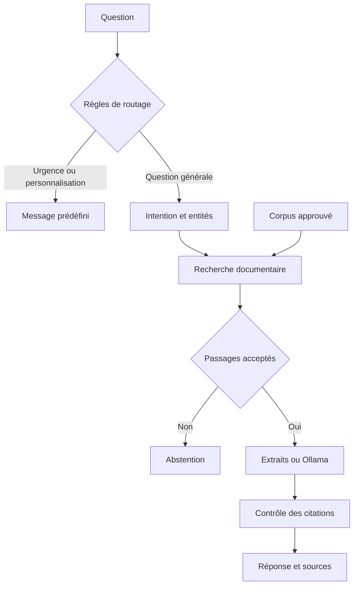

# Architecture de la version réalisée

## Décisions d’implémentation

Le moteur charge un corpus JSONL approuvé, le découpe et entraîne sa représentation lexicale. Le mode dense charge E5 sur CPU et réutilise un cache NumPy seulement si l’empreinte du corpus et le nom du modèle concordent. La recherche hybride fusionne les rangs ; les règles d’acceptation utilisent les scores des méthodes composantes.

Le modèle d’intention apprend sur le CSV au lancement. Il est purement descriptif : il ne décide pas si une urgence est réelle. Les entités sont extraites avec positions et une heuristique de négation. Ce choix permet un MVP léger mais ne remplace pas une NER biomédicale entraînée.

Les règles sont exécutées avant la recherche. Un refus de personnalisation ne prétend pas résoudre la demande de santé. Les questions arabes sont explicitement hors couverture après le filtre d’urgence limité. Les autres langues ne bénéficient d’aucune garantie de couverture.

## Différences avec la cible de conception

Le dossier de conception décrit une trajectoire d’amélioration. Cette version réalise le parcours de bout en bout sur un petit corpus. Il reste à constituer un corpus annoté représentatif, entraîner/évaluer une NER, établir une évaluation multilingue et tester la génération réelle sur la machine cible. Les réponses cliniques individuelles, l’authentification et l’usage public ne font pas partie du MVP.

## Sécurité et confidentialité

Pas de base de conversations ni de journalisation explicite des questions. Le navigateur utilise `textContent`, pas `innerHTML`, pour afficher les réponses et documents. Les liens rendus sont limités à HTTPS. Les données importées sont en attente de revue. Le client ne peut pas fournir d’URL Ollama ni choisir un chemin de fichier via l’API.

Le prompt ne constitue pas une protection absolue contre l’injection documentaire. Le contrôle des identifiants de citation ne prouve pas l’entailment. Le retour extractif évite une génération non contrôlée si le connecteur échoue ; les extraits doivent eux-mêmes avoir été validés. Aucune garantie d’exhaustivité des règles de sécurité n’est avancée.

## Évolution proposée

1. Ajouter 500–1 000 questions annotées et un jeu indépendant, regroupé par paraphrases.
2. Conserver des labels de pertinence multi-documents pour Recall@k et MRR.
3. Ajouter un modèle NER évalué au niveau entité, puis comparer au lexique.
4. Effectuer une revue humaine des réponses et abstentions, incluant les attaques par injection.
5. Élargir les thèmes et langues uniquement après mesures séparées.
